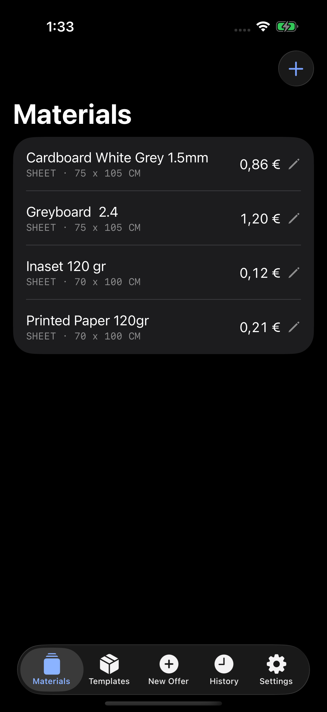
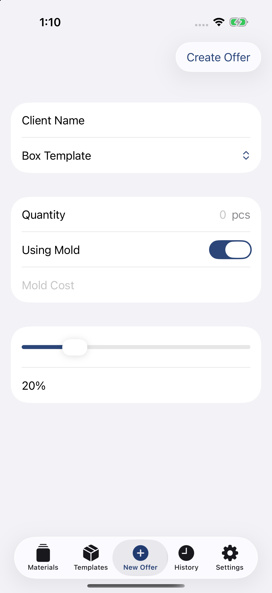
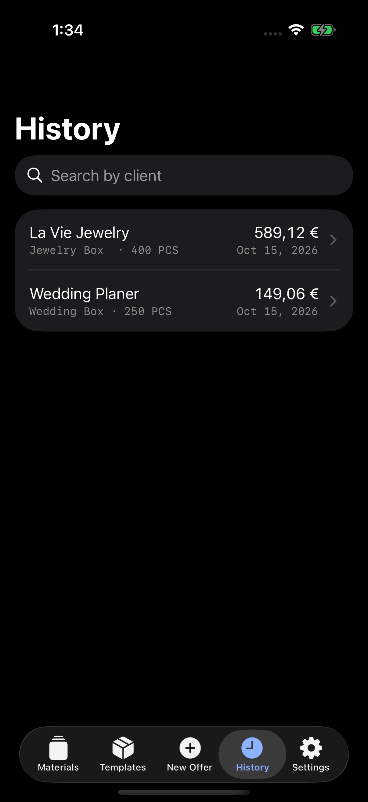
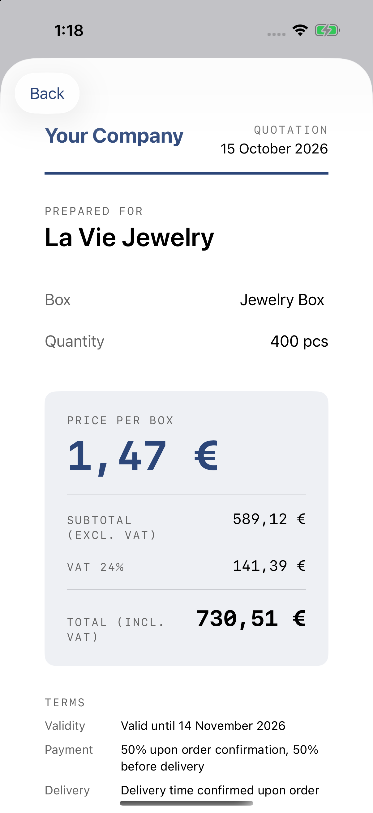

# RigidBoxQuoter

An iOS app for rigid-box manufacturers to keep raw material prices and turn
them into customer quotes with automatic cost calculation. Built as a
portfolio project with SwiftUI, SwiftData and MVVM, and based on real
production workflows.

<p>
  
  
  
  

</p>

## Features

- **Raw materials:** manage board and covering paper prices and sheet sizes.
- **Box templates:** define a box once (dimensions, lid height, assembly time,
  materials) and see the derived cut pieces live while typing.
- **Live quoting:** pick a template and a quantity and get price per box,
  total and breakdown instantly. Supports a one-off mold cost and a per-offer
  profit margin.
- **Offer history:** every quote is saved as a snapshot, searchable by customer.
- **Client-facing PDF:** export a clean quotation with VAT and terms. It never
  shows internal costs or margin.
- **Dark mode**, empty states and input validation throughout.

## How the price is calculated

The box is built from a base and a lid, each made of a structural board and a
covering paper. The calculator works out the four cut pieces, fits them onto
the material sheets (testing both orientations), counts the sheets needed and
adds labor, tooling and margin.

The formulas and the reasoning behind them are in [DESIGN.md](DESIGN.md).

## Architecture

- **SwiftUI + SwiftData**, MVVM.
- `PricingCalculator` is a plain, UI-independent type, so it is covered by unit tests.
- Offers are stored as snapshots, so later price changes never alter a quote
  already given to a customer.

Models/        SwiftData models (RawMaterial, BoxTemplate, Offer, AppSettings)
ViewModels/    Fetch/add/delete logic for materials and templates
Views/         SwiftUI screens
Services/      PricingCalculator, PDFGenerator, pricing value types
Extensions/    Small helpers (decimal parsing)

## Getting started

Requirements: Xcode 27.0, iOS 26.5.

```bash
git clone https://github.com/Billmorf/RigidBoxQuoter.git
open RigidBoxQuoter/RigidBoxQuoter.xcodeproj
```

Choose a simulator or device and press Run. Add a few materials and a box
template, set the hourly rate in Settings, and create your first offer.

## Tests

Press `⌘U` in Xcode. The unit tests (Swift Testing) cover piece dimensions,
sheet fitting, sheet count, material cost, the full offer calculation and
decimal parsing.

## Known issues and next steps

- A template whose pieces do not fit on its material sheets crashes the quote
  calculation. A fit check is planned (see DESIGN.md).
- Templates and offers cannot be edited yet, only created and deleted.
- Single currency (EUR); configurable currency and a default margin in Settings
  are planned.
- The company name and terms in the PDF are placeholders.

## Author

Vasilis Morfonidis, a computer science student with a background in
rigid-box production.